# 国先·问渠 管理台图文教程

> **给谁看**：管理员。不需要技术背景，照着图上的编号点就可以。
> **管理台地址**：<https://gxzx-coze-api.idea.edu.cn/main>
> **说明**：为了让教程不暴露真实数据，截图里的企业名、提问内容、文件名等做了模糊处理；实际页面以你看到的为准。
> **遇到问题**：把页面截图和报错文字发给平台同事（见第 12 节）。

---

## 目录

- [1. 登录](#1-登录)
- [2. 首页：看系统是否正常](#2-首页看系统是否正常)
- [3. 账号管理](#3-账号管理)
- [4. 数据浏览](#4-数据浏览)
- [5. 改数据、加记录、传文档](#5-改数据加记录传文档)
- [6. 访问日志](#6-访问日志)
- [7. 任务运维（看任务计划）](#7-任务运维看任务计划)
- [8. 上传导入](#8-上传导入)
- [9. Seed 管理](#9-seed-管理)
- [10. 管理配置（只看不改）](#10-管理配置只看不改)
- [11. 日常检查清单](#11-日常检查清单)
- [12. 遇到问题怎么办](#12-遇到问题怎么办)
- [13. 快速任务索引](#13-快速任务索引)

---

## 1. 登录

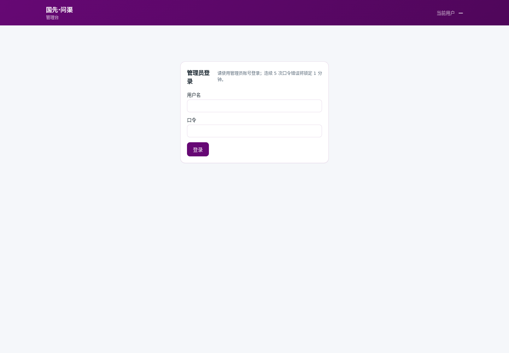

1. 打开 <https://gxzx-coze-api.idea.edu.cn/main>。
2. 在「用户名」里填：`admin`。
3. 在「口令」里填平台同事给你的密码。
4. 点「登录」。

**最容易错的地方**：`main` 是页面名字，不是用户名。用户名是 `admin`。

**口令复制注意**：口令文件末尾有一个换行，复制时只选那 16 位字符，不要把换行/空格带进去。

登录后，同一个页面会变成首页；如果页面又跳回登录页，说明登录过期，重新登录即可。

---

## 2. 首页：看系统是否正常

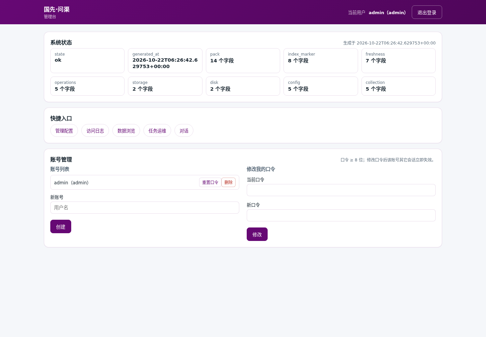

登录后从上往下看三块：

### 2.1 系统状态

- 看到 `state` 后面是 `ok`，说明系统总体正常。
- 看「发布版本 / 数据新鲜度」：数据是什么时候更新的，越近越好。
- 看「磁盘」：剩余空间越多越好。
- 卡片里有些英文是系统字段名，不用记；看到 `ok` 就放心，看到 `unavailable` / `missing` 就截图给平台同事。

### 2.2 快捷入口

首页中间的链接可以快速去：

- 管理配置
- 访问日志
- 数据浏览
- 任务运维
- 上传导入（有时会隐藏）
- Seed 管理（有时会隐藏）
- 对话

### 2.3 账号管理

首页下方是账号管理，见下一节。

---

## 3. 账号管理

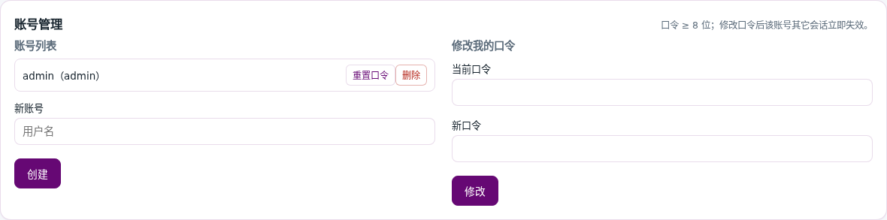

### 3.1 给同事开账号

1. 在「新账号」输入同事的用户名（例如 `zhangsan`，不要中文、不要空格）。
2. 点「创建」。
3. 页面会显示一行「新账号的初始口令（仅显示一次）」。
4. 马上把用户名和初始口令单独发给同事，让他登录后立刻改密。

> 初始口令只显示一次；刷新页面就看不到。没记下来只能「重置口令」。

### 3.2 重置同事的密码

1. 在「账号列表」找到账号。
2. 点「重置口令」。
3. 页面显示新的初始口令（只显示一次）。
4. 单独发给本人，让他登录后马上改。

> 点下去就生效，没有确认弹窗；旧密码不能再用，对方会被要求重新登录。重置前先和本人说一声。

### 3.3 删除账号

1. 在「账号列表」找到账号。
2. 点「删除」。

> 点下去就生效，不能撤销；**最后一个管理员不能删**（会提示 `last_account`）。删除前确认不是在职同事。

### 3.4 改自己的密码

1. 在「修改我的口令」里填「当前口令」和「新口令」（至少 8 位）。
2. 点「修改」。
3. 看到「口令已更新」就成功了。

---

## 4. 数据浏览

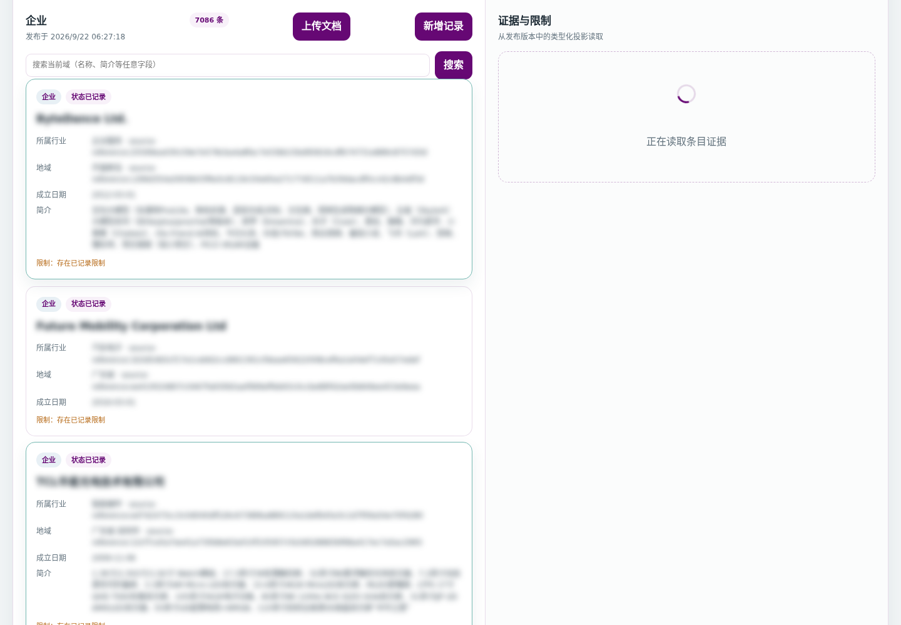

### 4.1 选领域和搜索

1. 点上方页签切换：企业 / 论文 / 专利 / 教授。
2. 在搜索框输入名称、标题或简介里的关键词。
3. 点「搜索」；点「清除」恢复全部。

列表默认每页 25 条，底部有「上一页 / 下一页」。

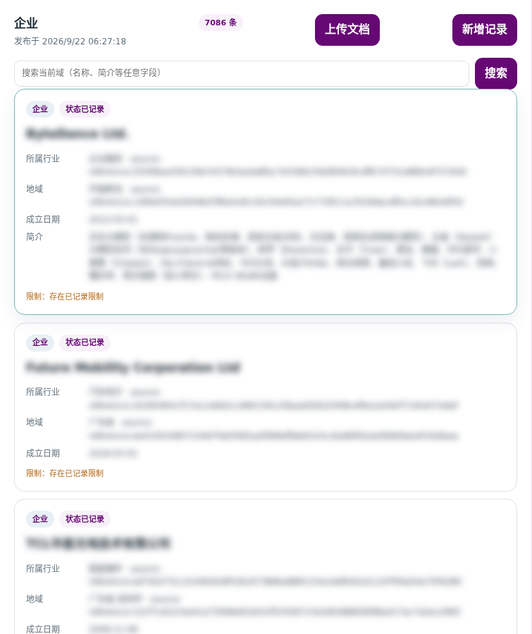

### 4.2 看一条数据的详情

点列表里的任意一条，右侧会出现「证据与限制」：

- **关键字段**：这条数据的主要信息。
- **证据标识**：这条数据来自哪里。
- **字段血缘**：这个字段是怎么来的。
- **限制**：使用限制。
- **修正记录**：以前谁改过、改了什么、为什么改。
- **查看关联**：看它和别的数据的关系。

> 截图里的企业名/字段值做了模糊处理；实际页面会显示真实内容。

---

## 5. 改数据、加记录、传文档

### 5.1 改一条数据（字段纠错）

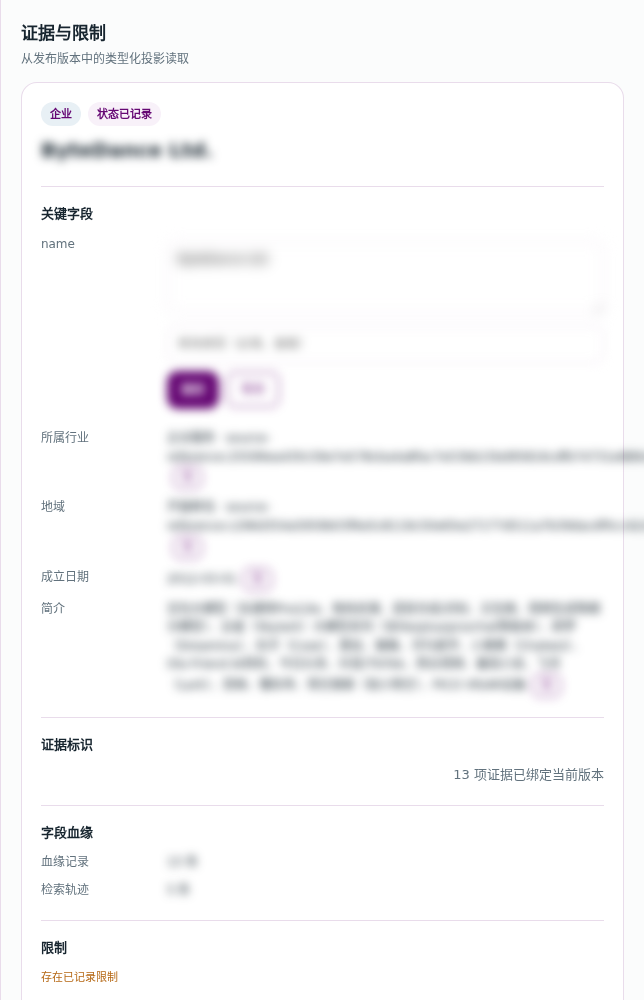

1. 打开一条数据的详情。
2. 在「关键字段」里找到要改的字段，点旁边的「改」。
3. 在文本框里填新内容。
4. 在「修改原因（必填）」里写清楚为什么改（例如“官网信息已更新”）。
5. 点「保存」。

保存后字段旁会出现「已修正」；下面「修正记录」里能看到这次修改，改错了可以点「撤销」。

> 浏览页会立即显示新值；对话页的回答要等平台同事下次更新数据后才会用上新值。

### 5.2 新增一条记录

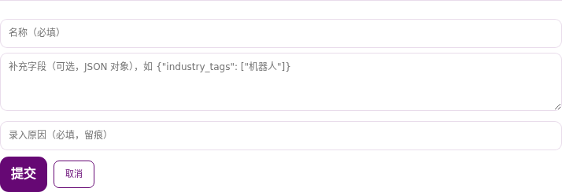

1. 在数据浏览左栏点「新增记录」。
2. 填「名称 / 标题」（必填）。
3. 「补充字段」可以留空；如果要填，按 `{"字段名": "值"}` 的格式，不确定就问平台同事。
4. 填「录入原因」（必填）。
5. 点「提交」。

> 新增的记录会立即进入对话检索。页面没有删除按钮；录错了联系平台同事。

### 5.3 上传企业文档

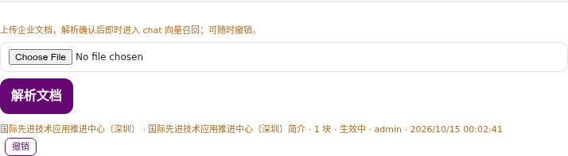

这个功能只在**企业**领域显示。支持 PDF、Word（.docx）、TXT、Markdown（.md）、Excel（.xlsx）。

Excel 会先识别表结构（企业/教授/专利/论文）和字段映射；预览显示识别结果，确认时可“按识别结构入库”写进对应数据表，或只用文本入库。

1. 企业领域 → 左栏「上传文档」。
2. 选择文件 → 点「解析文档」。
3. 检查预览文字，可以直接修改。
4. 填写企业名称（必填）、文档标题（可选）、关联企业 ID（可选）、入库原因（必填）。
5. 点「确认入库」。
6. 文档列表里出现这条记录；要撤销时点「撤销」。

> 当前单个文件建议不超过 **1MB**；超过会提示 `413` / `Request Entity Too Large`。大文件请压缩/拆分，或联系平台同事。
> 文档会立即进入对话检索，上传前确认内容准确、不涉密。

---

## 6. 访问日志

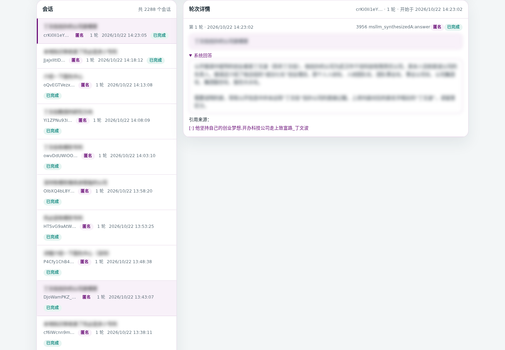

用途：看用户实际问了什么、系统怎么回答、有没有报错。

### 6.1 筛选

- 搜索框：按提问内容搜。
- 状态：全部 / 已完成 / 错误 / 中断。
- 提问类型、提问身份、开始/结束日期。
- 点「查询」应用筛选，点「重置」清空。

### 6.2 看会话和回答

- 左边是「会话」列表；点一个会话。
- 右边是「轮次详情」：用户问题、系统回答、引用来源、建议追问、耗时、状态。
- 上方「概览」有会话数、轮次、错误率、错误轮次、中断轮次、保留期。

### 6.3 导出

- 点「导出 CSV」或「导出 JSONL」，导出当前筛选范围内的数据。
- 导出文件可能含用户提问/业务信息，按公司规定保存，不要随意转发。

> 截图里的提问内容已模糊处理。页面时间按国际标准时间（UTC）显示，北京时间要加 8 小时。

---

## 7. 任务运维（看任务计划、跑日常采集）

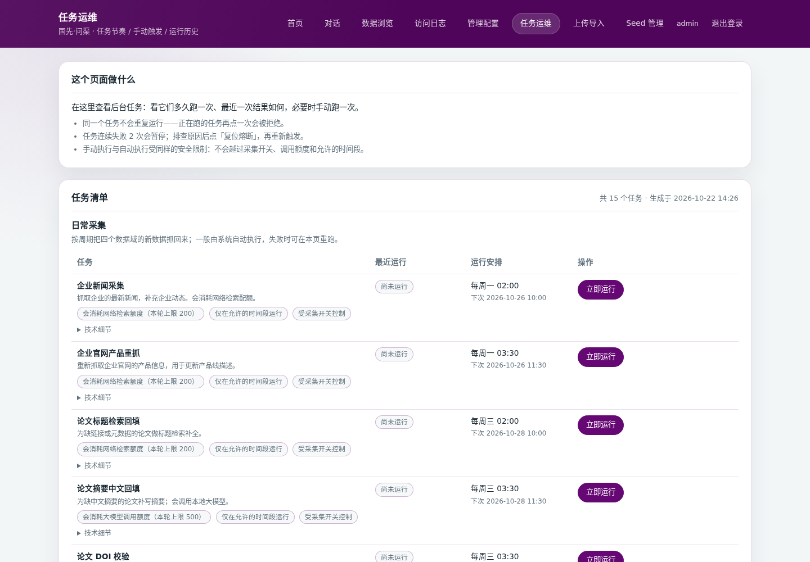

用途：看系统预定义的采集/导入任务和计划时间，并运行日常采集任务。

> **本机已启用「日常采集」的 7 个任务。**
>
> - **日常采集**：企业新闻、企业官网产品、论文检索/摘要/DOI、教授主页等任务都可以在这台服务器上运行；每次有条数上限，通常几分钟到几十分钟。
> - **教授采集源**：可以打开「Seed 管理」页，查看/新增/修改学校名册，点「检查名册」或「开始抓取」。
> - **高级操作 / 数据导入**：仍由平台侧执行，本机不要点。
> - 采集任务会消耗网络检索或大模型额度；只在允许的时间段、且采集开关打开时运行。

### 7.1 看任务

任务分成：

- 日常采集（7 个任务本机可跑）
- 数据导入（平台侧）
- 教授采集源（平台侧）
- 高级操作（一般不需要手动跑）

每个任务会显示运行安排、最近运行（本机跑过才有）、状态，以及「立即运行 / 复位熔断 / 查看」。

### 7.2 企业新闻采集怎么用

1. 找到「企业新闻采集」卡片。
2. 看「运行安排」：应显示「每周一 02:00」，「下次」是下周一 02:00（北京时间）。
3. 想马上补一次：点「立即运行」，确认后等待。一次最多处理 200 家企业，通常需要几分钟到几十分钟。
4. 运行过程中不要重复点；重复点会被系统拒绝（提示已有任务在跑）。
5. 点「查看」看运行详情：成功会显示抓取、写入的条数；失败会显示错误原因，把详情截图发给平台同事。
6. 如果显示「熔断」（连续失败 2 次会自动暂停）：不要反复点。先联系平台同事确认原因；原因排除后，可以点「复位熔断」，再点一次「立即运行」。

### 7.3 运行历史

- 每周一自动运行后，这里会出现一条由「周期」触发的记录。
- 手动点「立即运行」会出现一条由「手动」触发的记录。
- 历史为空或只有旧记录，说明还没到下一次运行时间；可以点「立即运行」验证。
- 如果出现「跳过 · 窗口外」：说明触发时间不在系统允许的凌晨时段；每周一 02:00 的自动运行在时段内，不会跳过。手动「立即运行」不受这个时段限制。
- 失败的记录不要连续重点，避免触发熔断。

### 7.4 其它采集任务

- 「企业官网产品重抓」「论文标题检索回填」「论文摘要中文回填」「论文 DOI 校验」「教授主页重爬」「教授主页论文增量」也在这台服务器上运行，每次有条数上限（20–100 条），可能耗时几分钟。
- 运行中不要重复点；重复点会被系统拒绝（提示已有任务在跑）。
- 「高级操作」（更新检索索引、预演、检索自检）、「数据导入」仍由平台侧执行，本机不要点。
- 看到灰色、不可用的任务，不要强点。
- 需要更新这些数据：按页面提示操作；不确定就先问平台同事。

### 7.5 教授采集源（Seed）

1. 点「教授采集源」→「去 Seed 管理页」。
2. 页面按学校列出现有名册；可以新增、修改、删除学校名册 URL。
3. 「检查名册」只验证能不能解析，不写入数据；「开始抓取」按选择的抓取范围真实抓取并写入。
4. 抓取会访问学校网站、消耗检索额度；运行中不要重复点。
5. 失败时点「查看」看原因，把详情截图发给平台同事。

---

## 8. 上传导入

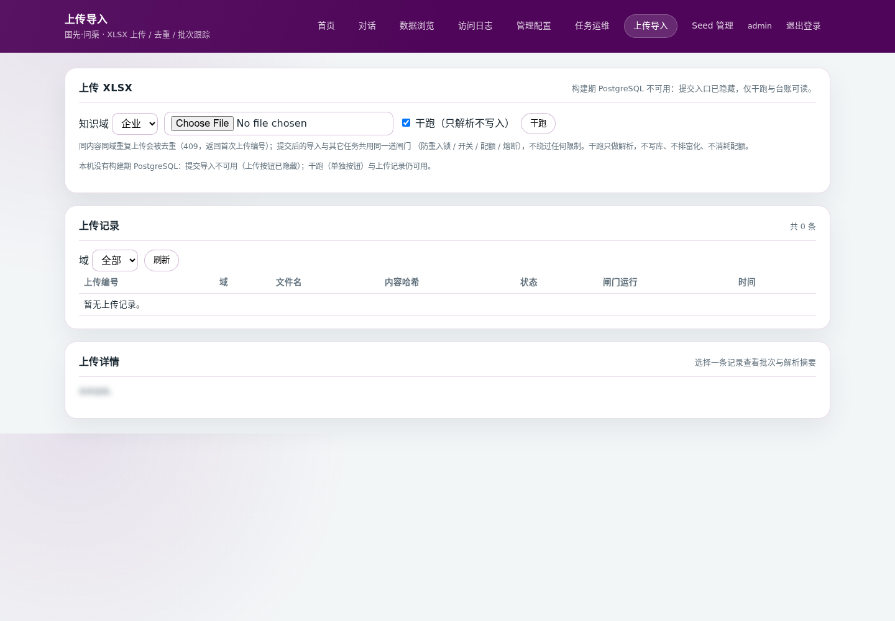

用途：把 Excel 表格（.xlsx）导入系统。

> **当前客户现场上传导入不可用**：页面会提示「构建期 PostgreSQL 不可用 / 提交入口已隐藏」，只能干跑检查表格。实际导入由平台侧执行；需要导入表格时联系平台同事。

### 8.1 操作步骤

1. 选择「知识域」：企业 / 专利 / 教授（不支持论文表格）。
2. 选择 `.xlsx` 文件。
3. **先干跑**：勾选「干跑（只解析不写入）」，点「干跑」。
4. 干跑没问题后，取消勾选，点「上传」（如果按钮可见）。
5. 导入结果由平台同事通知；当前现场不在本机跑导入任务。

### 8.2 上传记录

- 上传记录显示：上传编号、领域、文件名、内容指纹、状态、对应的导入任务、时间。
- 点一条记录，可以在「上传详情」看解析摘要和失败原因。
- 同一个文件重复上传会被拒绝（`duplicate_upload`），这是正常的去重。

### 8.3 当前限制

- 如果页面显示「构建期 PostgreSQL 不可用 / 提交入口已隐藏」，说明平台侧还没开启上传导入；**不是你的操作问题**，联系平台同事。
- 干跑通常仍然可用，可以用来检查表格。
- 文件太大提示 `413` 时，压缩/拆分后再试。

---

## 9. Seed 管理

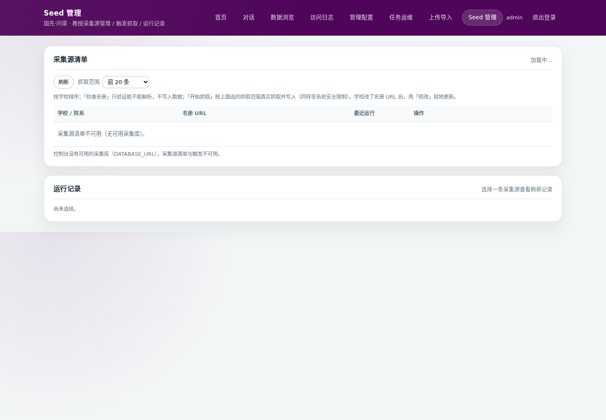

> 截图为功能示意；当前客户现场已启用 Seed 管理，页面会列出 185 条名册。

用途：维护“教授数据从哪里抓”：学校、院系、名册网址。

### 9.1 新增采集源

1. 填写「学校」（必填）。
2. 填写「院系」（可空）。
3. 填写「名册 URL」（必填，学校官网的教师名录页面）。
4. 点「新增采集源」。

> 名册 URL 必须是公开的教师名录页面，不要填内网地址、登录后的页面或带密码的链接。同一网址不能重复添加。

### 9.2 检查名册和抓取

1. 在「采集源清单」找到学校。
2. 先点「检查名册」：只检查能不能读，不写入数据。
3. 检查通过后，选择「抓取范围」：前 20 / 50 / 100 条，或全部。
4. 点「开始抓取」。
5. 到「运行记录」看结果。

### 9.3 当前状态

- 客户现场已启用 Seed 管理；页面能正常列出现有名册。
- 如果仍提示「采集源清单不可用」或「seed 管理不可用」，联系平台同事检查服务配置，不是你的操作问题。
- 「检查名册」和「开始抓取」都会真实访问学校网站；抓取会消耗检索额度，运行中不要重复点。

---

## 10. 管理配置（只看不改）

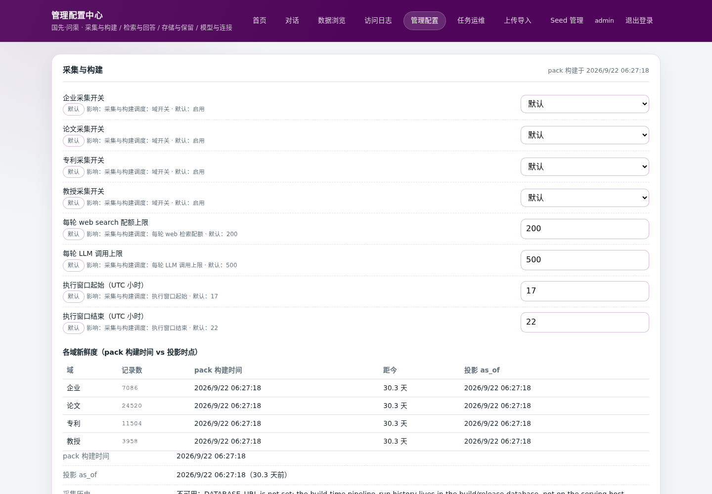

> **这一页是高级设置。日常不需要动。除非平台同事明确指导，不要修改任何字段、密钥或模型。**

四张卡片大致是：

| 卡片 | 大致作用 | 你需要做什么 |
|---|---|---|
| 采集与构建 | 控制四个领域是否采集、每轮最多用多少资源、什么时间段跑 | 一般不用动 |
| 检索与回答 | 控制检索/回答的运行参数 | 一般不用动 |
| 存储与保留 | 看数据文件、日志保留天数、磁盘空间 | 主要用来“看” |
| 模型与连接 | 看对话模型、采集模型、嵌入模型、重排、Web 搜索的连通性 | 主要用来“看”和“测试”；换模型/密钥必须由平台同事操作 |

### 10.1 你可以安全做的

- 看每张卡片的状态。
- 在平台同事指导下，点「测试连通性」。
- 点开最下面的「只读快照」，看当前设置（只读）。

### 10.2 不要做的

- 不要改「采集开关」「资源额度」「时间窗口」。
- 不要改「模型名」「服务地址（Base URL）」「密钥」。
- 不要点「清除密钥」。
- 不要改存储/索引路径。
- 不确定就不要点「保存本卡」。

### 10.3 保存 ≠ 立即生效

- 「保存本卡」只是把设置存下来，运行中的系统不会马上变。
- 大多数设置要平台同事重启服务后才生效。
- **不要自己重启服务器**；把页面提示截图发给平台同事。

---

## 11. 日常检查清单

### 每天（2 分钟）

- [ ] 登录管理台，看首页 `state` 是否 `ok`。
- [ ] 看「访问日志」的错误率有没有明显升高。
- [ ] 看「系统状态」里的磁盘剩余空间是否还够。

### 每周（10 分钟）

- [ ] 看「数据浏览 → 知识缺口」，把用户反馈多的问题整理给平台同事。
- [ ] 看「访问日志」的错误率趋势，异常时截图给平台同事。
- [ ] 和平台同事确认本周的数据更新/导入是否完成。
- [ ] 需要留存的访问日志，导出 CSV/JSONL。

### 每月（30 分钟）

- [ ] 检查账号：离职/换岗的账号删掉，长期不用的重置或删除。
- [ ] 改一次自己的密码。
- [ ] 和数据/业务同事确认：最近有没有需要新增或纠正的数据。
- [ ] 和平台同事确认备份是否正常。

---

## 12. 遇到问题怎么办

### 12.1 常见提示

| 你看到的提示 | 大概意思 | 你可以怎么做 |
|---|---|---|
| `invalid_credentials` / 「用户名或口令错误」 | 用户名或密码不对 | 用户名是 `admin`；确认密码；注意大小写 |
| `locked` / 429 / 「请 N 秒后重试」 | 密码错太多次，被临时锁定 | 等提示的秒数；不要连续试 |
| 页面跳回登录页 / `authentication_required` | 登录过期 | 重新登录 |
| `current_password_incorrect` | 改密码时“当前密码”填错 | 重新填当前密码 |
| `last_account` | 不能删除最后一个管理员 | 先建一个新管理员，再删 |
| `account_exists` | 用户名已存在 | 换一个用户名 |
| `duplicate_upload` | 这个文件已经上传过 | 用提示里的第一次上传编号；不要重复传 |
| `413 Request Entity Too Large` | 文件太大 | 压缩/拆分；或联系平台同事 |
| `upload_requires_postgres` / 「提交导入不可用」 | 平台侧未开启上传导入 | 联系平台同事；干跑仍可用 |
| `console_database_not_configured` / 「seed 管理不可用」 | 平台侧未开启 Seed 管理 | 联系平台同事 |
| `job_breaker_open` / 「任务已熔断」 | 任务连续失败，自动暂停 | 把运行详情发给平台同事；不要自己复位 |
| `job_already_running` | 任务正在跑 | 等它跑完 |
| `cross_site_request_refused` | 页面安全校验失败 | 刷新页面、重新登录；还不行就截图给平台同事 |
| `unavailable` / `missing` | 某个技术组件状态异常 | 问答正常就先忽略；异常时截图给平台同事 |

### 12.2 联系平台同事时，请提供

1. **截图**：整个页面，包括报错文字。
2. **时间**：大概几点、什么操作之后出现。
3. **页面**：首页 / 数据浏览 / 访问日志 / 任务运维 / 上传导入 / Seed 管理 / 管理配置。
4. **你做了什么**：点了哪个按钮、填了什么内容（不要发密码）。
5. **影响范围**：只有你这里出现，还是其他人也不行；对话页还能不能用。

### 12.3 不要做的事

- 不要把密码、初始口令、密钥发到群里/邮件里。
- 不要删除最后一个管理员账号。
- 不要在没有和本人确认的情况下重置/删除别人的账号。
- 不要在平台同事不知情时改「管理配置」里的模型、密钥、路径。
- 不要连续点「登录」「立即运行」「复位熔断」；企业新闻采集运行中不要重复点。
- 不要自己重启服务器或修改系统设置。

---

## 13. 快速任务索引

| 我想…… | 去哪里 | 怎么做 |
|---|---|---|
| 登录 | 管理台首页 | 用户名 `admin` + 密码 → 登录 |
| 改自己的密码 | 首页 → 账号管理 | 填当前口令和新口令 → 修改 |
| 给同事开账号 | 首页 → 账号管理 | 输入用户名 → 创建 → 把初始口令单独发给本人 |
| 重置同事密码 | 首页 → 账号管理 | 找到账号 → 重置口令 → 新口令单独发给本人 |
| 删除账号 | 首页 → 账号管理 | 找到账号 → 删除（确认不是最后一个管理员） |
| 看系统是否正常 | 首页 → 系统状态 | 看 `state` 是否 `ok`、数据是否新鲜、磁盘是否够 |
| 查一家企业 | 数据浏览 → 企业 | 搜索名称/关键词 → 点条目看详情 |
| 改一条数据 | 数据浏览 → 对应领域 | 点条目 → 关键字段旁「改」→ 填新值+原因 → 保存 |
| 新增一条记录 | 数据浏览 → 对应领域 | 新增记录 → 填名称/标题+原因 → 提交 |
| 上传企业文档 | 数据浏览 → 企业 | 上传文档 → 解析 → 检查/编辑 → 确认入库 |
| 看用户问了什么 | 访问日志 | 按时间/关键词/状态筛选 → 点会话看轮次 |
| 导出访问日志 | 访问日志 | 筛选 → 导出 CSV/JSONL |
| 跑一次企业新闻采集 | 任务运维 | 找到「企业新闻采集」→「立即运行」；每周一 02:00 也会自动跑 |
| 跑论文/教授采集 | 任务运维 | 找到对应任务 →「立即运行」；每次限 20–100 条，可能耗时几分钟 |
| 看任务计划 | 任务运维 | 企业新闻可手动跑；其它任务只看计划/历史，不要点「立即运行」 |
| 上传 Excel 表格 | 上传导入 | 当前现场只能干跑；实际导入联系平台同事 |
| 新增教授采集源 | Seed 管理 | 新增采集源 → 填学校/院系/名册 URL → 提交；再点「检查名册」或「开始抓取」 |
| 改高级设置 | 管理配置 | 先联系平台同事，不要自己改 |
| 页面报错/不会做 | 本教程第 12 节 | 截图 + 时间 + 页面 + 操作过程，发给平台同事 |

---

> **使用提醒**：本教程的截图来自实际管理台，数据已做模糊处理；页面按钮或流程变化时，以实际页面为准，并告诉平台同事更新教程。
